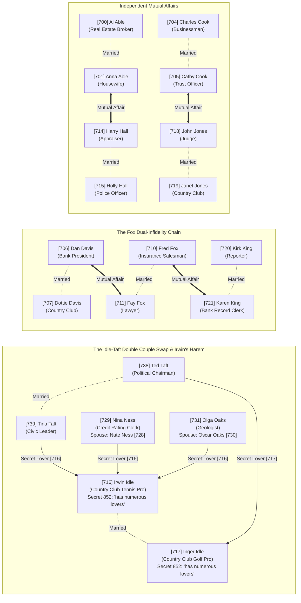
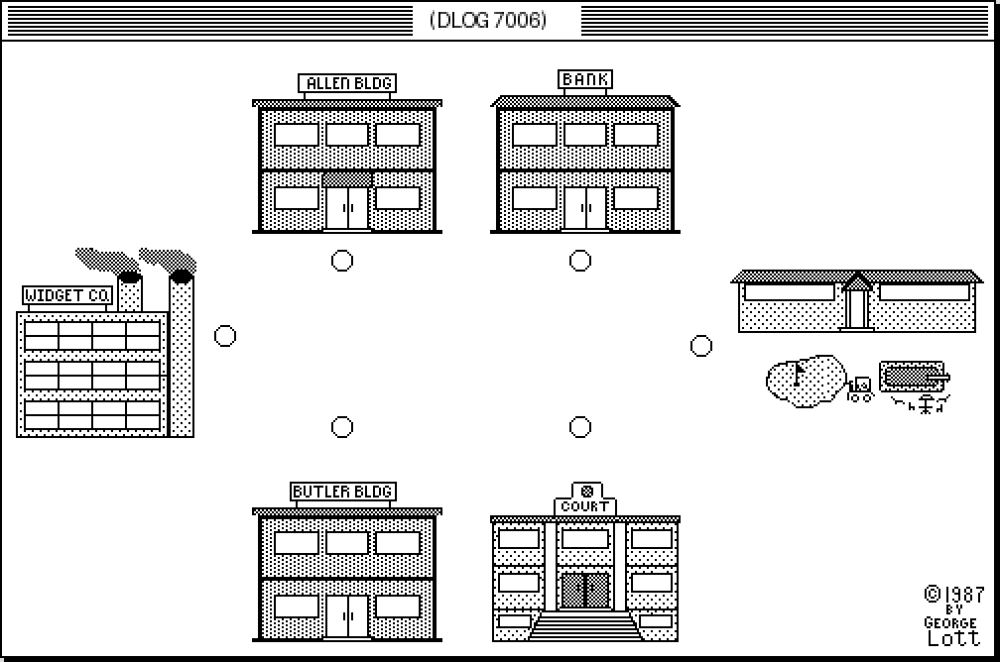
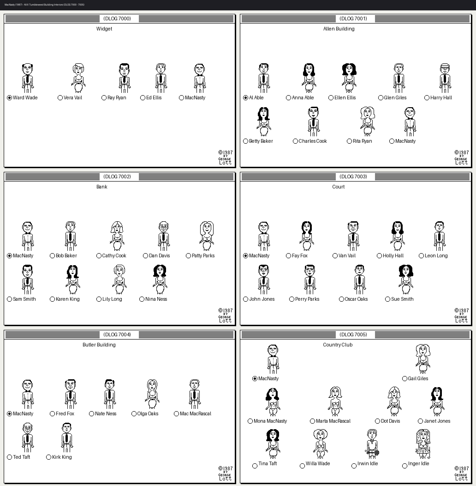
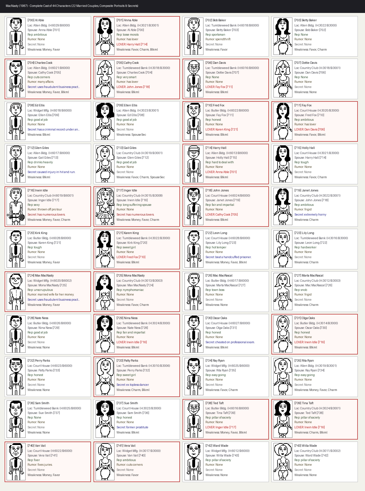
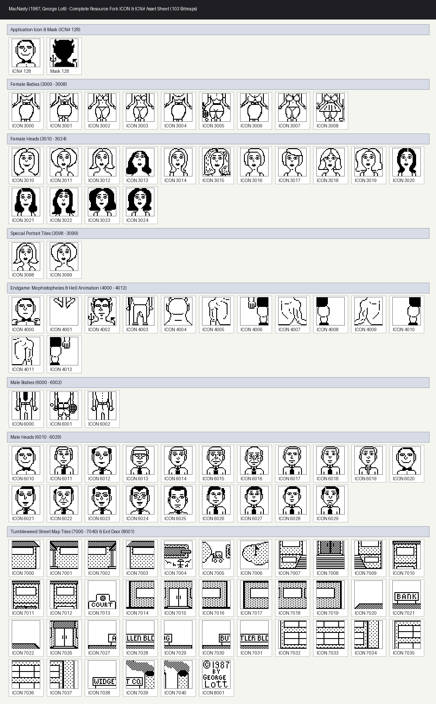

# MacNasty (1987) — Complete Reverse-Engineering, Asset & Affair Guide

> [!NOTE]
> **Historical & Technical Provenance**
> *MacNasty* (Version 1.00, 1987) is a Classic Macintosh (68000, System 6) satirical political/business strategy shareware game written by **George Lott** (`P.O. Box 13834, Arlington, TX 76013`, creator signature `MNTY`). All data, disassembly, dialogs, bitmaps, and mechanics in this guide were extracted directly from the original binary resource fork on the **SoftShoppe #5691** 800KB HFS floppy disk image (`SoftShoppe5691.img.sit`).

---

## 1. Archive Extraction & Binary Provenance

| Stage | Artifact / File | Format / Algorithm | Size | Details |
| :--- | :--- | :--- | :--- | :--- |
| **1. Outer Archive** | [SoftShoppe5691.img.sit](reference/macnasty/SoftShoppe5691.img.sit) | StuffIt 5 (`Method 15` / `"Arsenic"`) | 141,591 B | BWT (`block_bits=6`, 128 KB blocks) + MTF + Zero-RLE + Adaptive Arithmetic Coding |
| **2. Disk Image** | [SoftShoppe5691.img](reference/macnasty/SoftShoppe5691.img) | Apple 800KB HFS Floppy Image | 819,284 B | 84-byte DiskCopy header + 819,200-byte HFS volume (`CRC32 = 0xa52b8de6`) |
| **3. Application** | [MacNasty_.rsrc](reference/macnasty/extracted/MacNasty_.rsrc) | Classic Mac Resource Fork (`APPL`/`MNTY`) | 141,397 B | Data fork = 0 bytes; 100% of code and assets reside in the 166-entry Resource Fork |
| **4. Disassembly** | [CODE_01.txt](reference/macnasty/disasm/CODE_01.txt) .. [CODE_23.txt](reference/macnasty/disasm/CODE_23.txt) | Motorola 68000 Machine Code | 24 segments | Compiled with TML Pascal / MPW Pascal (`LINK A6`, A5-relative globals and jump table) |

---

## 2. Complete Affair Network ("Who Is Schtooping Who")

In Tumbleweed, Texas, the town's **44 characters (`ID 700..743`)** consist of **22 married couples** (`even ID = husband`, `odd ID = wife = husband + 1`). Hiring the **Private Detective** (`Info -> Private Detective`, `$500` per investigation, implemented in [CODE_04.txt](reference/macnasty/disasm/CODE_04.txt)) queries each character's 18-byte A5 global record (`+4` Secret ID and `+10` Lover ID), exposing a tangled web of **12 unfaithful spouses** across **8 couples**, plus the player's own 3-slot seduction system:

### Detailed Breakdown of Every Affair in the Binary (`CODE_3` & `CODE_4`)

1. **The Fox–Davis–King Dual Infidelity Chain**:
   - **Fred Fox (`710`, Insurance Salesman)** and **Fay Fox (`711`, Lawyer)** are married to each other, and *both* are having secret affairs with other married townspeople:
   - **Fay Fox (`711`)** $\leftrightarrow$ **Dan Davis (`706`, Bank President, married to Dottie Davis `707`)**: Mutual affair (`706` has `+4=850, +10=711`; `711` has `+4=850, +10=706`).
   - **Fred Fox (`710`)** $\leftrightarrow$ **Karen King (`721`, Bank Record Clerk, married to Reporter Kirk King `720`)**: Mutual affair (`710` has `+4=850, +10=721`; `721` has `+4=850, +10=710`).
2. **The Idle–Taft Double Couple Swap & Irwin Idle's Three Married Lovers**:
   - **Irwin Idle (`716`, Country Club Tennis Pro)** and **Inger Idle (`717`, Country Club Golf Pro)** are married to each other. Both carry Secret `852` (`"has numerous lovers"`).
   - **Ted Taft (`738`, Political Chairman)** and **Tina Taft (`739`, Civic Leader)** are touted publicly as `"pillar of society"` (`Rep 760`), but are in a complete **cross-couple swap** with the Idles:
     - **Ted Taft (`738`)** has Secret `850`: Lover is **Inger Idle (`717`)**.
     - **Tina Taft (`739`)** has Secret `850`: Lover is **Irwin Idle (`716`)**.
   - In addition to **Tina Taft (`739`)**, two other married women in Tumbleweed have **Irwin Idle (`716`)** as their secret lover (`+4=850, +10=716`):
     - **Nina Ness (`729`, Credit Rating Clerk at the Bank)** — married to **Nate Ness (`728`, Tax Appraiser)**, whose public reputation is `"good at job"` while Nina's is `"fair and impartial"`.
     - **Olga Oaks (`731`, Geologist at the Butler Building)** — married to **Oscar Oaks (`730`, District Attorney)**, who has his own secret (`857`: `"cheated on professional exam."`).
3. **Anna Able (`701`) $\leftrightarrow$ Harry Hall (`714`)**:
   - **Anna Able (`701`, married to Broker Al Able `700`)** and **Harry Hall (`714`, Real Estate Appraiser, married to Police Officer Holly Hall `715`)** are in a mutual affair (`701` has Lover=`714`; `714` has Lover=`701`). Both work/hang out inside the **Allen Building (`DLOG 7001`)** right next to Anna's husband Al Able (`700`)!
4. **Cathy Cook (`705`) $\leftrightarrow$ Judge John Jones (`718`)**:
   - **Cathy Cook (`705`, Bank Trust Officer)** is married to **Charles Cook (`704`, Businessman)**, whose rumor is `"many affairs"` (`808`). Meanwhile, Cathy is actually in a mutual affair with **Judge John Jones (`718`)** (`705` has Lover=`718`; `718` has Lover=`705`), while Judge Jones's wife **Janet Jones (`719`)** is at the Country Club with Rumor `802` (`"frigid"`) and Secret `858` (`"extremely horny"`).
5. **Max & Mona MacNasty (`724` & `725`)**:
   - Your character, **Max MacNasty (`724`)**, has Rumor `811` (`"married wife for her money."`), while your wife **Mona MacNasty (`725`)** lounges at the Country Club with Reputation `772` (`"nymphomaniac"`). During gameplay ([CODE_17.txt](reference/macnasty/disasm/CODE_17.txt)), Mona periodically triggers random scandal events:
     - *"You had a fight with your wife Mona. She went to a bar, got drunk, and danced on the table in her underwear. Lose 5 prestige points."*
     - *"Your wife Mona was arrested after shooting at a traffic cop with her pearl handled revolver. Legal fees and fines cost you $5000."*
     - *"Your wife Mona got mad when you stayed out all night. She threw a lamp through the picture window. Repairs cost $500."*
6. **Player Seduction & The 3-Slot Mistress State Machine ([CODE_12.txt](reference/macnasty/disasm/CODE_12.txt) & [CODE_20.txt](reference/macnasty/disasm/CODE_20.txt))**:
   - Choosing `Bribe -> Seduce` (`$300` cost) checks if the target character ID is odd (female). If you select an even (male) ID, the game prints: `"No, no. We don't do that kind of thing around here."`
   - If you select your own wife **Mona MacNasty (`725`)**, she replies: `"Forget it Max, you turn me off."`
   - Seducing any other female character opens the Persuade dialog (`DLOG 6003`). If successful, she is assigned to one of **3 active mistress slots** in A5 global memory (`Slot 1 = -1988(A5)`, `Slot 2 = -1996(A5)`, `Slot 3 = -2004(A5)`) and assigned one of three multi-turn affair arcs (`300`, `301`, or `302`) processed each turn in `CODE 20`:
     - **Seducing Marta MacRascal (`727`, wife of your arch-rival Mac MacRascal `726`)** grants an immediate **+10 Prestige** bonus!
     - Each turn, active mistresses advance through stages (`+6` stage counter in the slot record): they demand gifts (`$500`), threaten to tell your wife Mona unless paid (`$2000`), or ask you to spend the weekend with them. If you seduce a 4th woman when all 3 slots are full, the oldest mistress breaks up with you in anger and turns against you (`-10` relationship penalty).

---

## 3. Visual Asset Catalog & Reconstructed Screens

### 3.1 Tumbleweed Town Map (`DLOG 7006` — "On the street")

The main street view of Tumbleweed, Texas (`500×310` pixels) is constructed from **51 32×32 `ICON` tiles (`7000..7040`, `8001`)** and **6 radio buttons** positioned in `DITL 7006`:

### 3.2 All 6 Tumbleweed Building Interiors (`DLOG 7000..7005`)

Clicking any of the 6 radio buttons on the street map opens that building's interior dialog (`DLOG 7000` Widget Mfg., `DLOG 7001` Allen Building, `DLOG 7002` Bank, `DLOG 7003` Court House, `DLOG 7004` Butler Building, `DLOG 7005` Country Club). Each character is rendered by stacking a **32×32 Head `ICON`** directly above a **32×32 Body `ICON`**, with a radio button underneath to select them for `Info`, `Bribe`, or `Blackmail`:

### 3.3 Complete Cast of 44 Characters (`ID 700..743`)

Every character's composite portrait (`Head ICON` + `Body ICON`), location, spouse, public reputation, rumor, private detective secret/lover, and persuasion weaknesses (red-bordered cards indicate characters actively involved in secret affairs):

### 3.4 Complete `ICON` & `ICN#` Bitmap Sheet (All 103 Bitmaps)

> [!TIP]
> **Hidden Finder Icon Easter Egg (`ICN# 128`)**
> Look at the top-left of the asset sheet below: `ICN# 128` (the desktop application icon) has a normal smiling businessman (`Max MacNasty`) in its 1-bit **Icon Data**, but its 1-bit **Mask** (`Mask 128`) is a silhouette of **the Devil with horns and a pitchfork**! In the Classic Mac Finder, single-clicking the application icon inverts the icon against its mask, transforming Max MacNasty into the Devil right on your desktop.

---

## 4. Master Dossier of All 44 Characters (`ID 700..743`)

In [CODE_03.txt](reference/macnasty/disasm/CODE_03.txt) (`0x0450..0x0DDA`), all 44 characters are initialized in A5-relative global memory (`-868(A5)` down to `-1642(A5)`, 18 bytes per character).

### 4.1 18-Byte Character Struct Layout

| Offset | Size | Field | Meaning |
| :--- | :--- | :--- | :--- |
| `+0` | `u16` | `job_cat_id` | Influence category ID (`450..469`, or `0` for non-official/civic/spouse) summed by `CODE_1+0x208C` |
| `+2` | `u8` | `vuln_blackmail` | `1` = susceptible to `Blackmail -> Threaten disclosure` |
| `+4` | `u16` | `secret_id` | Secret string ID (`850..863`, or `0`) revealed by `Info -> Private Detective` (`$500`) |
| `+6` | `u8` | `vuln_money` | `1` = susceptible to `Bribe -> Money` |
| `+7` | `u8` | `vuln_favors` | `1` = susceptible to `Bribe -> Favors` |
| `+8` | `u8` | `has_affair` | `1` = unfaithful (modifies Persuade odds when referencing spouse vs. lover) |
| `+10` | `u16` | `lover_id` | Secret Lover's Character ID (`700..743`, or `0`) when `secret_id == 850` |
| `+12` | `u16` | `rumor_id` | Rumor string ID (`800..811`, `753`, or `0`) shown by `Info -> Rumors` |
| `+14` | `u16` | `rep_id` | Reputation string ID (`750..773`, or `0`) shown by `Info -> Rumors` |
| `+16` | `u8` | `vuln_charm` | `1` = susceptible to `Bribe -> Charm` |
| `+17` | `u8` | `vuln_spouse_sec` | `1` = susceptible to `Blackmail -> Spouse's Secrets` (only `Ellen Ellis 709` & `Gail Giles 713`) |

### 4.2 Complete 44-Character Database

| ID | A5 Offset | Name | Spouse | Building (`DLOG`) | Head / Body `ICON` | Public Job (`CODE_5`) | Cat ID (`+0`) | Reputation (`+14`) | Rumor (`+12`) | Detective Secret (`+4`) | Secret Lover (`+10`) | Effective Tactics (`+2,+6,+7,+16,+17`) |
| :--- | :--- | :--- | :--- | :--- | :--- | :--- | :--- | :--- | :--- | :--- | :--- | :--- |
| **700** | `-868(A5)` | **Al Able** | Anna Able (`701`) | Allen Bldg (`7001 #1`) | `6029 / 6000` | Real Estate Broker | `459` | `ambitious` (`750`) | None | None | — | Money, Favors |
| **701** | `-886(A5)` | **Anna Able** | Al Able (`700`) | Allen Bldg (`7001 #2`) | `3021 / 3001` | Housewife | `0` | `loose morals` (`765`) | `has lover` (`801`) | `lover is ...` (`850`) | **Harry Hall (`714`)** | Favors, Charm, Blackmail |
| **702** | `-904(A5)` | **Bob Baker** | Betty Baker (`703`) | Bank (`7002 #2`) | `6018 / 6000` | Bank Loan Officer | `464` | `sportsman` (`766`) | `spendthrift` (`805`) | None | — | Favors |
| **703** | `-922(A5)` | **Betty Baker** | Bob Baker (`702`) | Allen Bldg (`7001 #6`) | `3022 / 3000` | Newspaper Reporter | `453` | None | None | None | — | Favors, Charm |
| **704** | `-940(A5)` | **Charles Cook** | Cathy Cook (`705`) | Allen Bldg (`7001 #7`) | `6021 / 6000` | Businessman | `466` | `cuts corners` (`753`) | `many affairs` (`808`) | `uses fraudulent business practices.` (`863`) | — | Money, Favors, Blackmail |
| **705** | `-958(A5)` | **Cathy Cook** | Charles Cook (`704`) | Bank (`7002 #3`) | `3018 / 3000` | Bank Trust Officer | `455` | `very smart` (`771`) | `has lover` (`801`) | `lover is ...` (`850`) | **John Jones (`718`)** | Blackmail |
| **706** | `-976(A5)` | **Dan Davis** | Dottie Davis (`707`) | Bank (`7002 #4`) | `6016 / 6000` | Bank President | `464` | None | None | `lover is ...` (`850`) | **Fay Fox (`711`)** | Blackmail |
| **707** | `-994(A5)` | **Dottie Davis** | Dan Davis (`706`) | Country Club (`7005 #7`) | `3018 / 3001` | Housewife / Socialite | `0` | None | None | None | — | *(None — seduce/rumors only)* |
| **708** | `-1012(A5)` | **Ed Ellis** | Ellen Ellis (`709`) | Widget Mfg (`7000 #4`) | `6018 / 6000` | Quality Control Inspector | `454` | `good at job` (`757`) | None | `has a criminal record under another name.` (`856`) | — | Blackmail |
| **709** | `-1030(A5)` | **Ellen Ellis** | Ed Ellis (`708`) | Allen Bldg (`7001 #3`) | `3023 / 3001` | Real Estate Broker | `459` | `good at job` (`757`) | None | None | — | **Spouse's Secrets** (Ed's record!) |
| **710** | `-1048(A5)` | **Fred Fox** | Fay Fox (`711`) | Butler Bldg (`7004 #2`) | `6022 / 6000` | Insurance Salesman | `468` | `honest` (`759`) | None | `lover is ...` (`850`) | **Karen King (`721`)** | Blackmail |
| **711** | `-1066(A5)` | **Fay Fox** | Fred Fox (`710`) | Court House (`7003 #2`) | `3020 / 3000` | Lawyer | `461` | `ambitious` (`750`) | `has lover` (`801`) | `lover is ...` (`850`) | **Dan Davis (`706`)** | Favors, Blackmail |
| **712** | `-1084(A5)` | **Glen Giles** | Gail Giles (`713`) | Allen Bldg (`7001 #4`) | `6017 / 6000` | Real Estate Appraiser | `457` | `drinks heavily` (`751`) | None | `caused injury in hit and run.` (`855`) | — | Blackmail |
| **713** | `-1102(A5)` | **Gail Giles** | Glen Giles (`712`) | Country Club (`7005 #2`) | `3019 / 3001` | Country Club Manager | `456` | `good at job` (`757`) | None | None | — | Favors, Charm, **Spouse's Secrets** |
| **714** | `-1120(A5)` | **Harry Hall** | Holly Hall (`715`) | Allen Bldg (`7001 #5`) | `6013 / 6000` | Real Estate Appraiser | `469` | `hard to deal with` (`770`) | None | `lover is ...` (`850`) | **Anna Able (`701`)** | Blackmail |
| **715** | `-1138(A5)` | **Holly Hall** | Harry Hall (`714`) | Court House (`7003 #4`) | `3021 / 3000` | Police Officer | `452` | `tough` (`769`) | None | None | — | Favors, Charm |
| **716** | `-1156(A5)` | **Irwin Idle** | Inger Idle (`717`) | Country Club (`7005 #3`) | `6019 / 6001` | Country Club Tennis Pro | `456` | `sexy` (`763`) | `thrown off pro tour` (`809`) | `has numerous lovers` (`852`) | *(3 wives: `729, 731, 739`)* | Money, Favors, Charm |
| **717** | `-1174(A5)` | **Inger Idle** | Irwin Idle (`716`) | Country Club (`7005 #4`) | `3015 / 3008` | Country Club Golf Pro | `456` | `long suffering spouse` (`761`) | None | `has numerous lovers` (`852`) | *(Ted Taft `738`)* | Money, Favors, Charm |
| **718** | `-1192(A5)` | **John Jones** | Janet Jones (`719`) | Court House (`7003 #6`) | `6024 / 6000` | Judge | `462` | `fair and impartial` (`756`) | None | `lover is ...` (`850`) | **Cathy Cook (`705`)** | Blackmail |
| **719** | `-1210(A5)` | **Janet Jones** | John Jones (`718`) | Country Club (`7005 #8`) | `3022 / 3001` | Socialite | `0` | `ambitious` (`750`) | `frigid` (`802`) | `extremely horny` (`858`) | — | Charm |
| **720** | `-1228(A5)` | **Kirk King** | Karen King (`721`) | Butler Bldg (`7004 #7`) | `6028 / 6000` | Newspaper Reporter | `453` | `tough` (`769`) | None | None | — | Money, Favors |
| **721** | `-1246(A5)` | **Karen King** | Kirk King (`720`) | Bank (`7002 #7`) | `3022 / 3000` | Bank Record Clerk | `450` | `sweet girl` (`764`) | None | `lover is ...` (`850`) | **Fred Fox (`710`)** | Blackmail |
| **722** | `-1264(A5)` | **Leon Long** | Lily Long (`723`) | Court House (`7003 #5`) | `6028 / 6000` | Police Detective | `452` | `hot temper` (`768`) | None | `beat a handcuffed prisoner.` (`859`) | — | Money, Favors, Blackmail |
| **723** | `-1282(A5)` | **Lily Long** | Leon Long (`722`) | Bank (`7002 #8`) | `3016 / 3000` | Bank Trust Officer | `455` | `hard worker` (`758`) | None | None | — | Charm |
| **724** | `-1300(A5)` | **Max MacNasty** | Mona MacNasty (`725`) | All 6 Buildings (`#1/#5/#9`) | `6020 / 6002` | Player Character | `0` | `unscrupulous` (`767`) | `married wife for her money.` (`811`) | `uses fraudulent business practices.` (`863`) | — | Money, Favors *(Self)* |
| **725** | `-1318(A5)` | **Mona MacNasty** | Max MacNasty (`724`) | Country Club (`7005 #5`) | `3013 / 3003` | Player's Wife (Heiress) | `0` | `nymphomaniac` (`772`) | None | None | — | Favors, Charm |
| **726** | `-1336(A5)` | **Mac MacRascal** | Marta MacRascal (`727`) | Butler Bldg (`7004 #5`) | `6017 / 6000` | Arch-Rival / Town Boss | `466` | `town boss` (`773`) | None | None | — | *(Immune)* |
| **727** | `-1354(A5)` | **Marta MacRascal** | Mac MacRascal (`726`) | Country Club (`7005 #6`) | `3012 / 3003` | Rival's Wife | `0` | `snob` (`762`) | `frigid` (`802`) | None | — | Charm *(+10 Prestige if seduced!)* |
| **728** | `-1372(A5)` | **Nate Ness** | Nina Ness (`729`) | Butler Bldg (`7004 #3`) | `6026 / 6000` | Tax Appraiser | `451` | `good at job` (`757`) | None | None | — | *(None — Start Rumors only)* |
| **729** | `-1390(A5)` | **Nina Ness** | Nate Ness (`728`) | Bank (`7002 #9`) | `3024 / 3000` | Credit Rating Clerk | `450` | `fair and impartial` (`756`) | None | `lover is ...` (`850`) | **Irwin Idle (`716`)** | Blackmail |
| **730** | `-1408(A5)` | **Oscar Oaks** | Olga Oaks (`731`) | Court House (`7003 #8`) | `6027 / 6000` | District Attorney | `463` | `honest` (`759`) | None | `cheated on professional exam.` (`857`) | — | Blackmail |
| **731** | `-1426(A5)` | **Olga Oaks** | Oscar Oaks (`730`) | Butler Bldg (`7004 #4`) | `3014 / 3000` | Geologist | `460` | `honest` (`759`) | None | `lover is ...` (`850`) | **Irwin Idle (`716`)** | Blackmail |
| **732** | `-1444(A5)` | **Perry Parks** | Patty Parks (`733`) | Court House (`7003 #7`) | `6023 / 6000` | Judge | `462` | `honest` (`759`) | None | None | — | *(None — leverage via wife `733`)* |
| **733** | `-1462(A5)` | **Patty Parks** | Perry Parks (`732`) | Bank (`7002 #5`) | `3010 / 3006` | Bank Loan Officer | `464` | `sweet girl` (`764`) | None | `ex topless dancer` (`851`) | — | Charm, Blackmail |
| **734** | `-1480(A5)` | **Ray Ryan** | Rita Ryan (`735`) | Widget Mfg (`7000 #3`) | `6025 / 6000` | Widget Co. Executive | `467` | `easy going` (`755`) | None | None | — | Favors, Charm |
| **735** | `-1498(A5)` | **Rita Ryan** | Ray Ryan (`734`) | Allen Bldg (`7001 #8`) | `3019 / 3001` | Oil Landman | `458` | `easy going` (`755`) | None | None | — | Money, Favors, Charm |
| **736** | `-1516(A5)` | **Sam Smith** | Sue Smith (`737`) | Bank (`7002 #6`) | `6025 / 6000` | Bank Trust Officer | `455` | None | None | None | — | *(None — leverage via wife `737`)* |
| **737** | `-1534(A5)` | **Sue Smith** | Sam Smith (`736`) | Court House (`7003 #9`) | `3023 / 3000` | Lawyer | `461` | `honest` (`759`) | None | `former prostitute` (`854`) | — | Blackmail |
| **738** | `-1552(A5)` | **Ted Taft** | Tina Taft (`739`) | Butler Bldg (`7004 #6`) | `6016 / 6000` | Political Chairman | `465` | `pillar of society` (`760`) | None | `lover is ...` (`850`) | **Inger Idle (`717`)** | Money, Favors, Blackmail |
| **739** | `-1570(A5)` | **Tina Taft** | Ted Taft (`738`) | Country Club (`7005 #9`) | `3024 / 3001` | Civic Leader | `0` | `pillar of society` (`760`) | None | `lover is ...` (`850`) | **Irwin Idle (`716`)** | Charm, Blackmail |
| **740** | `-1588(A5)` | **Van Vail** | Vera Vail (`741`) | Court House (`7003 #3`) | `6022 / 6000` | Lawyer | `461` | `fixer` (`752`) | `fixes juries.` (`810`) | None | — | Money, Favors |
| **741** | `-1606(A5)` | **Vera Vail** | Van Vail (`740`) | Widget Mfg (`7000 #2`) | `3017 / 3000` | Quality Control Inspector | `454` | `ambitious` (`750`) | `cuts corners` (`753`) | None | — | Favors |
| **742** | `-1624(A5)` | **Ward Wade** | Willa Wade (`743`) | Widget Mfg (`7000 #1`) | `6012 / 6000` | Widget Co. President | `467` | `pillar of society` (`760`) | None | None | — | *(None — Start Rumors only)* |
| **743** | `-1642(A5)` | **Willa Wade** | Ward Wade (`742`) | Country Club (`7005 #10`) | `3011 / 3002` | Socialite | `0` | `pillar of society` (`760`) | None | None | — | *(None — Seduce/Rumors)* |

---

## 5. Complete Resource Fork Inventory (166 Resources)

All 166 resources extracted into [rsrc_dump/](reference/macnasty/rsrc_dump):

| Resource Type | Count | IDs | Purpose |
| :--- | :--- | :--- | :--- |
| `CODE` | 24 | `0..23` | 68000 executable code segments (`CODE 0` jump table + 23 code modules) |
| `ICON` | 101 | `3000..8001` | 128-byte (32×32 1-bit) bitmaps: Female bodies (`3000..3008`), Female heads (`3010..3024`, `3098..3099`), Endgame devils (`4000..4012`), Male bodies (`6000..6002`), Male heads (`6010..6029`), Street map tiles (`7000..7040`), Copyright/Exit tile (`8001`) |
| `ICN#` | 1 | `128` | 256-byte Finder icon (Max MacNasty face) + devil-with-pitchfork mask |
| `DLOG` | 14 | `6000..6003`, `6010`, `7000..7008` | Dialog templates: Buy (`6000`), Sell (`6001`), Score (`6002`), Persuade (`6003`), Borrow (`6010`), 6 Buildings (`7000..7005`), Street Map (`7006`), Yes/No Decision (`7007`), Shareware Intro (`7008`) |
| `DITL` | 14 | `6000..6003`, `6010`, `7000..7008` | Dialog item lists defining coordinates of every icon, radio button, push button, and text field |
| `MENU` | 5 | `1..5` | Menu bar: `Apple` (`1`), `Action` (`2`: Score, Next Person, Leave Building, Pass, Quit), `Property` (`3`: Buy, Sell, Borrow), `Info` (`4`: Public Facts, Rumors, Private Detective), `Bribe` (`5`: Money, Favors, Charm, Seduce), `Blackmail` (`6` via menu ID `5`/`6`: Threaten disclosure, Start Rumors, Spouse's Secrets) |
| `CNTL` | 3 | `130, 131, 156` | Scrollbar control (`130`: `"How much?"` for `Bribe -> Money` `$0..$10,000`) and buttons (`131` `"OK"`, `156` `"Leave"`) |
| `WIND` | 1 | `1` | Main message/story window (`"Message"`, bounds `(46, 7, 336, 505)`) |
| `STR#` | 1 | `1001` | 3 strings: `"Save Data File"`, `"Data"`, `"Too Much Information"` |
| `MNTY` / `vers` | 2 | `0`, `2` | Signature `"Version 1.00 Copyright 1987 by George Lott"` |
| `BNDL` / `FREF` / `PREC` | 4 | `128, 129`, `0` | Finder bundle, file reference (`APPL`), and print record |

---

## 6. 68000 `CODE` Segment Architecture & Game Mechanics

### 6.1 Complete 23-Segment Map

| Segment | Disassembly File | Size | Primary Responsibility |
| :--- | :--- | :--- | :--- |
| `CODE 0` | [CODE_0.bin](reference/macnasty/rsrc_dump/CODE_0.bin) | 608 B | A5 Jump Table (`2,476` bytes above A5, `2,522` bytes below A5) |
| `CODE 1` | [CODE_01.txt](reference/macnasty/disasm/CODE_01.txt) | 8,900 B | Main loop, menu dispatcher, PRNG (`_Random`), category influence calculator (`0x208C`), bankruptcy screen |
| `CODE 2` | [CODE_02.txt](reference/macnasty/disasm/CODE_02.txt) | 1,750 B | Shareware screen (`$15` to George Lott, P.O. Box 13834, Arlington, TX 76013) |
| `CODE 3` | [CODE_03.txt](reference/macnasty/disasm/CODE_03.txt) | 3,558 B | Uncle Sawdust MacNasty intro narrative & 44-character A5 table initialization (`0x0450..0x0DDA`) |
| `CODE 4` | [CODE_04.txt](reference/macnasty/disasm/CODE_04.txt) | 4,296 B | `Info -> Rumors` (free) & `Info -> Private Detective` (`$500` fee; reveals `+4` Secret & `+10` Lover) |
| `CODE 5` | [CODE_05.txt](reference/macnasty/disasm/CODE_05.txt) | 9,532 B | `Info -> Public Facts` (44 per-character functions printing job, spouse name, and spouse job) |
| `CODE 6` | [CODE_06.txt](reference/macnasty/disasm/CODE_06.txt) | 2,068 B | `Action -> Score` (`DLOG 6002`: Cash, Debt, Gross Worth, Prestige for MacNasty vs. MacRascal, plus Age) |
| `CODE 7` | [CODE_07.txt](reference/macnasty/disasm/CODE_07.txt) | 4,030 B | `Property -> Buy` (`DLOG 6000`: Widget Co., Bank, Allen Bldg, Butler Bldg, Newspaper, Country Club) |
| `CODE 8` | [CODE_08.txt](reference/macnasty/disasm/CODE_08.txt) | 3,794 B | `Property -> Sell` (`DLOG 6001`: sell 1, 2, 5, 10, 25, or 50 shares) |
| `CODE 9` | [CODE_09.txt](reference/macnasty/disasm/CODE_09.txt) | 2,174 B | `Property -> Borrow` (`DLOG 6010`: `$10k..$500k` loan gated by Bank `464` & Clerk `450` influence) |
| `CODE 10` | [CODE_10.txt](reference/macnasty/disasm/CODE_10.txt) | 1,796 B | Character ID (`700..743`) to Pascal string name resolver (`0x0234`) |
| `CODE 11` | [CODE_11.txt](reference/macnasty/disasm/CODE_11.txt) | 4,062 B | `Blackmail` (`Threaten disclosure`, `Start Rumors` `$200`, `Spouse's Secrets`) & Persuade dialog (`DLOG 6003`) |
| `CODE 12` | [CODE_12.txt](reference/macnasty/disasm/CODE_12.txt) | 4,024 B | `Bribe -> Charm` & `Bribe -> Seduce` (`$300`) + mistress slot allocation |
| `CODE 13` | [CODE_13.txt](reference/macnasty/disasm/CODE_13.txt) | 2,944 B | `Bribe -> Favors` & `Bribe -> Money` (`CNTL 130` scrollbar `$0..$10,000`) |
| `CODE 14` | [CODE_14.txt](reference/macnasty/disasm/CODE_14.txt) | 3,750 B | Building & Street Map dialog controllers (`DLOG 7000..7006`, `7008`) |
| `CODE 15` | [CODE_15.txt](reference/macnasty/disasm/CODE_15.txt) | 8,368 B | 4 Trust appointments/ousters (`Aardvark`, `Baloney`, `Coldfish`, `Dipstik`) & Mayoral election |
| `CODE 16` | [CODE_16.txt](reference/macnasty/disasm/CODE_16.txt) | 8,362 B | Consulting fees (Bank, Widget, Country Club), lawsuits (`$50k`/`$20k`), IRS audits, heart attacks, inheritances |
| `CODE 17` | [CODE_17.txt](reference/macnasty/disasm/CODE_17.txt) | 6,416 B | Board of Directors elections, oil wells, environmental fines, Country Club blackballing, Mona MacNasty scandals |
| `CODE 18` | [CODE_18.txt](reference/macnasty/disasm/CODE_18.txt) | 1,704 B | Turn-end event dispatcher |
| `CODE 19` | [CODE_19.txt](reference/macnasty/disasm/CODE_19.txt) | 2,718 B | Annual financial settlement (dividends, loan interest, salaries, aging) |
| `CODE 20` | [CODE_20.txt](reference/macnasty/disasm/CODE_20.txt) | 5,092 B | 3-slot Mistress/Affair state machine (`-1988(A5)`, `-1996(A5)`, `-2004(A5)`) |
| `CODE 21` | [CODE_21.txt](reference/macnasty/disasm/CODE_21.txt) | 9,556 B | Horse racing bets against MacRascal & `J. Marmaduke Dirty` criminal schemes (`DLOG 7007`) |
| `CODE 22` | [CODE_22.txt](reference/macnasty/disasm/CODE_22.txt) | 1,680 B | MacRascal AI stock purchasing & bankruptcy check |
| `CODE 23` | [CODE_23.txt](reference/macnasty/disasm/CODE_23.txt) | 2,940 B | Endgame death sequence & Mephistopheles Hell animation (`ICON 4000..4012`) |

### 6.2 Persuasion & Influence Mechanics (`CODE 11..13` & `CODE 1`)

1. **Relationship Array (`-1956(A5)`)**:
   - Each character `700..743` has a signed 16-bit relationship/influence score (`-10..+10`) stored in an array starting at `-1956(A5)` (`index = cid - 700`).
   - Whenever an event checks your clout in a profession (e.g., `455` Trust Officers, `461` Lawyers, `462` Judges, `464` Bankers), `CODE_1+0x208C` sums the relationship scores of all characters whose `+0` category matches that profession, plus half the relationship score of their spouses!
2. **Persuade Dialog (`DLOG 6003`)**:
   - After a successful `Bribe` (`Money`, `Favors`, `Charm`, `Seduce`) or `Blackmail` (`Threaten disclosure`, `Start Rumors`, `Spouse's Secrets`), the `Persuade` dialog (`DLOG 6003`) opens with 5 targets:
     1. **Yourself** (`+2` to `+5` direct relationship boost with the target)
     2. **Spouse** (`700^1`: boosts your standing with the target's spouse, *unless* `+8` `has_affair == 1`, in which case an unfaithful spouse has a lower/negative chance of swaying their partner!)
     3. **Lover** (only succeeds if `+8` `has_affair == 1` and the target actually has a lover in `+10` — boosts your standing with their secret lover!)
     4. **Boss** (boosts your standing with the head of their building/company, e.g., `Dan Davis 706` at the Bank or `Ward Wade 742` at Widget Mfg.)
     5. **Other** (general prestige/town influence boost)

### 6.3 J. Marmaduke Dirty Schemes & Horse Racing (`CODE 21`)

- **Horse Racing Bets against MacRascal**:
  1. `$1,000` bet on MacRascal's horse `Faster Than Light` (`50%` win chance).
  2. `$5,000` bet on MacRascal's horse `Lightning` (`50%` win chance).
  3. `$20,000` bet against the champion horse `Old Gray` — if you accept, MacRascal **poisons `Old Gray`** before the race! Unless your influence with Police (`452`) is high enough to expose him, you lose `$20,000` and `5` Prestige.
- **Fraternity Brother `J. Marmaduke Dirty`**:
  - Periodically visits with 4 high-risk illegal schemes (`DLOG 7007` Yes/No):
    1. **Stealing Oil (`$5,000` investment)**: Returns `$25,000` profit if successful, or arrest (`$20,000` fine + `-10` Prestige) if caught (mitigated by Police `452`, DA `463`, Judge `462`, and Lawyer `461` influence).
    2. **Salted Oil Well Scam (`$10,000` investment)**: Returns `$50,000` if Geologist (`460` Olga Oaks) and Landman (`458` Rita Ryan) don't expose you; otherwise `$30,000` lawsuit.
    3. **Zoning/Factory Bribery Scam (`$15,000` investment)**: Returns `$60,000` if Political Chairman (`465` Ted Taft) and Appraisers (`457`/`469`) back you.
    4. **Armored Car / Bank Robbery (`$20,000` investment)**: Returns `$100,000` if successful, or heavy fine/prison scandal if Police (`452`) catch Dirty.

### 6.4 Endgame: Mephistopheles & Hell (`CODE 23`)

When Max MacNasty reaches the end of his lifespan (around age 70, or earlier via heart attack in `CODE 16`):
- **If your final score (Gross Worth + Prestige) is lower than MacRascal's**:
  > *"Here you are at the end of your life. And what have you accomplished? Not much. Even though you were given a fine evil name to uphold, you let that upstart MacRascal beat you."*
- **If you beat MacRascal**:
  `CODE 23` clears the window and animates **Mephistopheles** (`ICON 4000..4003`) and two dancing **Devils** (`ICON 4004..4012`) across the screen:
  > *"Well Max, your life is over. Look around, someone is coming to meet you. Why, it's Mephistopheles! And he's brought a couple of his helpers."*
  > *"Welcome to Hell, Max. You're our kind of guy. Follow me, we have a hot time in store for you."*

---

## How to Play MacNasty (Windows, macOS & Browser)

1. **Zero-Install macOS / Windows / Browser App ([macnasty.html](macnasty.html) / [index.html](index.html))**:
   - Double-click [macnasty.html](macnasty.html) on macOS or Windows to play immediately in Safari, Chrome, or Firefox (includes the embedded MacNasty_.rsrc resource fork and a toggleable **Detective Cheat Sheet**).
2. **Native Windows Rust Application (src/bin/macnasty.rs)**:
   `powershell
   cargo run --release --bin macnasty
   `
3. **Original 1987 68k Macintosh Floppy Image ([
eference/macnasty/SoftShoppe5691.img](reference/macnasty/SoftShoppe5691.img))**:
   - Drag-and-drop 
eference/macnasty/SoftShoppe5691.img onto [Infinite Mac (System 6.0.2)](https://infinitemac.org/1988/System%206.0.2) or **Mini vMac** to boot the original 1987 800KB HFS floppy disk.
